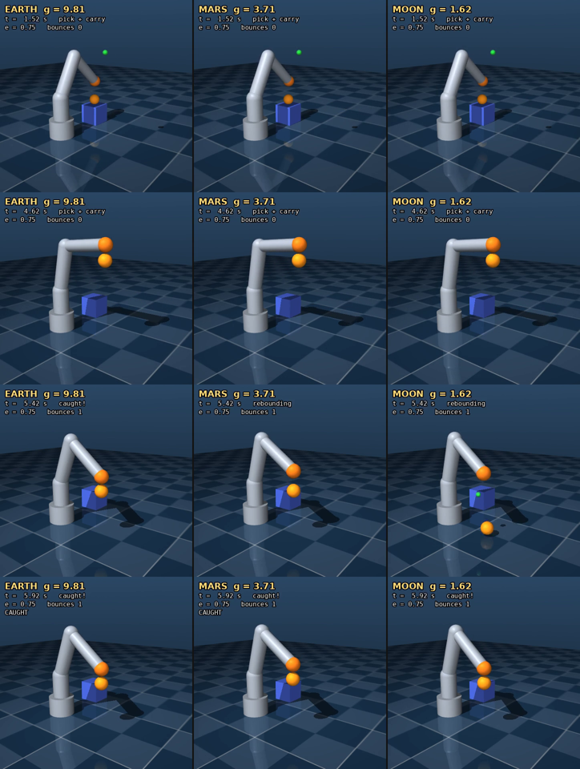

# mujoco-arm-rl

Reinforcement learning on a **3-joint MuJoCo manipulator** that must bring its
end-effector onto a random target anywhere in its workspace **and hold it
there**. One environment, two trainers:

| Trainer | Script | What it gives you |
| --- | --- | --- |
| **Stable-Baselines3** (SAC / TQC) | `scripts/train_sb3.py` | Batteries included; the measured-best recipe. |
| **TorchRL** (clipped PPO) | `scripts/train_torchrl.py` | Every piece explicit — collector, GAE, PPO epochs, optimiser step. |

**Headline** (held-out benchmark, 100 fixed start/target pairs): SAC reaches
**100 % success at 5 cm and 95–98 % at 2 cm, with a median final error of ~6 mm**,
after 30k steps (~7 min on 2 CPU cores). The analytic-IK reference controller
scores 5.7 mm. The original version of this repo scored **0–1 %** on the same
benchmark.

---

## Quick start

```bash
conda create -n mujoco-rl python=3.11 -y && conda activate mujoco-rl
pip install -r requirements.txt

python scripts/view_random.py                                   # does MuJoCo work?
python scripts/evaluate.py --ckpt oracle --render human         # what "good" looks like
python scripts/train_sb3.py --timesteps 30000 --out runs/sb3_v1 # ~7 min on CPU
python scripts/evaluate.py --ckpt runs/sb3_v1/best_model.zip --render human
python scripts/benchmark.py --entry "mine=runs/sb3_v1/best_model.zip" --entry oracle
```

`pytest -q` runs 34 contract tests (16 reach, 18 ball catch); the C++ side has 16 more
(`ros2/README.md`). On a headless machine, set
`MUJOCO_GL=disable` for anything that does not open a window.

---

## The robot

`assets/arm3.xml`: shoulder pan (z), shoulder pitch (y), elbow (y). The pitch
joint sits at **(0, 0, 0.22)** and the tip reaches **0.50 m** from it; the elbow
limit of ±2.6 rad means nothing closer than ~0.13 m to the shoulder is reachable.
Gravity is on. The green sphere is a mocap body used as the target.

## The task: `MujocoArm3Reach-v1`

| | |
| --- | --- |
| **Control** | Policy outputs *changes* to joint targets, rate-limited to 3 rad/s; a PD servo inside MuJoCo (kp = 200/300/150, critically damped from the joint-space inertia) turns them into torque, capped at the motor limits. |
| **Rate** | 25 Hz decisions, 2 s episodes (50 steps), never terminated early — reach *and hold*. |
| **Goals** | Uniform by volume in the workspace, kept only if the analytic IK finds a collision-free solution inside the joint limits. |
| **Observation** (24) | `cos q`, `sin q`, `q̇/10`, servo error, previous action, tip position, target position, `10·(target − tip)` |
| **Reward** | `−d + (1 − tanh(d / 5 cm)) − 0.02‖a‖² − 0.02‖a − a_prev‖²` |

The linear term pulls from far away; the `tanh` term gives a strong gradient in
the last few centimetres, which is where precision comes from; the two small
action penalties make the arm settle instead of dither.

`MujocoArm3Reach-v0` is the original task (raw torques at 100 Hz, 200-step
episodes, the old sampler and reward, 18-dim obs). It is kept so old checkpoints
still load — `evaluate.py` recognises them automatically — and so the ablation
is reproducible. `--env-kwarg control_mode=torque` etc. switches any piece back.

---

## What changed, and what each change was worth

### Two bugs found by auditing the task, not by tuning

1. **A permanent contact on the pan joint.** link1's capsule sat 4.5 cm inside
   the base cylinder. MuJoCo skips parent–child collisions, *except* when the
   parent is welded to the world — which the base is. So every step of every
   episode had a penetrating contact adding friction to joint 1. Fixed with a
   `<contact><exclude>` in the MJCF; regression-tested.
2. **4.3 % of training targets were physically unreachable.** The old sampler
   centred its shell on joint 1 (z = 0.10) instead of the pitch joint
   (z = 0.22), so some targets landed inside the elbow's minimum reach. Found by
   writing an analytic IK (verified against MuJoCo FK to 1e-15 m) and checking
   20,000 samples. The new sampler only produces targets IK says are reachable.

### Ablation

SAC, 30k agent steps per run (equal gradient updates = equal compute), scored on
the held-out benchmark. **Seed 0 only** — the multi-seed run was stopped part way,
so treat single-point differences of a few percent as noise. Rows are cumulative.

| Config | Success @5 cm | Success @2 cm | Median final dist | Time to reach |
| --- | --- | --- | --- | --- |
| A — original recipe (v0 task, lr 3e-4, γ 0.98) | 1 % | 0 % | 165 mm | — |
| B — + tuned SAC (lr 1e-3, γ 0.95) | 0 % | 0 % | 249 mm | — |
| C — + 25 Hz, reachable goals, richer obs (still torque) | 97 % | 49 % | 20 mm | 0.30 s |
| D — + position servo | 98 % | 48 % | 20 mm | 0.53 s |
| **E — + shaped reward (= v1)** | **100 %** | **95 %** | **5.8 mm** | 0.52 s |
| IK oracle (scripted reference) | 100 % | 100 % | 5.7 mm | 0.52 s |
| random actions | 0 % | 0 % | 539 mm | — |

What the data says — including where it contradicted the plan:

- **The task formulation was the big lever (C), not the algorithm (B).** Tuning
  SAC on the old task did nothing. Changing the control rate, goal distribution
  and observation took success from ~0 % to 97 %. Row C bundles three changes;
  `scripts/ablation.py` has a `C0_rate` config that isolates the 25 Hz change,
  not yet run.
- **The position servo did not help accuracy** (D ≈ C), and it made reaching
  *slower* (0.53 s vs 0.30 s), because the 3 rad/s rate limit is the bottleneck.
  It is still the default because it gives smooth, bounded motion and it is how
  real arms are commanded, but that is a design choice, not a measured win.
  `X_fast` (6 rad/s limit) and `X_torque` (v1 with raw torques) in the ablation
  script test this directly; not yet run.
- **The shaped reward is what buys precision (E):** success at 2 cm 48 % → 95 %,
  median error 20 mm → 5.8 mm, essentially matching the IK reference.

### Hyperparameters (SAC on v1, 30k steps, seed 0)

| lr | γ | @5 cm | @2 cm | Median |
| --- | --- | --- | --- | --- |
| 3e-4 | 0.98 | 97 % | 71 % | 14.6 mm |
| **1e-3** | **0.95** | **100 %** | **98 %** | **6.3 mm** |

At 25 Hz, γ = 0.95 is a ~0.8 s effective horizon, matching a ~0.5 s reach.

---

## Evaluating properly

```bash
python scripts/benchmark.py \
    --entry "SAC=runs/seed*/best_model.zip" \
    --entry oracle --entry random --out results.json
```

- **Frozen held-out set**: `benchmarks/eval_set_v1.json`, 100 (start pose,
  target) pairs, generated once and never regenerated.
- **Metrics at the end of the 2 s episode**: success at 5 cm and 2 cm, median
  final distance, time to first reach, fraction of the last 0.5 s held inside 5 cm.
- **Multiple seeds**: every checkpoint matched by one `--entry` glob is a seed;
  brackets are 95 % stratified-bootstrap CIs (seeds, then episodes within seeds).
- **The IK oracle** — analytic IK driven through the same rate-limited action
  interface — is the reference ceiling: if a policy is far from it, the problem
  is learning, not physics.

Training-time numbers from SB3's logger are a single seed on random targets
with exploration noise. Use them to watch a run, not to compare runs.

## Training

```bash
python scripts/train_sb3.py                       # v1, 60k steps (configs/sb3_sac.yaml)
python scripts/train_sb3.py --algo tqc            # TQC from sb3-contrib
python scripts/train_sb3.py --target 0.3 0.0 0.35 # one fixed goal
python scripts/train_torchrl.py                   # PPO, 300k frames, keeps best held-out checkpoint
python scripts/ablation.py --jobs 2               # reproduce the table above (all seeds)
```

Each run writes `env_config.json` beside its checkpoints recording the env ID
and kwargs, and `evaluate.py` / `benchmark.py` read it back. A policy is always
evaluated on the task it trained on — no repeating `--target` by hand.

`--threads 1` when running several seeds in parallel; on 2 cores, two
single-threaded runs give ~2× the throughput of one.

**TorchRL status:** the rewritten PPO trainer (held-out evaluation, best
checkpoint, advantage normalisation, v1 task) is smoke-tested end to end but has
**not** had a full-length run yet, so there is no measured PPO number on v1.

### A note on TorchRL versions

TorchRL renames public API between releases (`SyncDataCollector` → `Collector`,
`entropy_coef` → `entropy_coeff`). `train_torchrl.py` resolves both at import
time rather than pinning a version. TorchRL checkpoints are reloaded in plain
PyTorch by replaying the saved `ObservationNorm` statistics; the checkpoint
records which convention was used (`obs * scale + loc` by default), because
getting it backwards silently yields a policy that scores worse than random.

---

## Ball catch: pick, drop, catch — on Earth, Mars and the Moon



`media/catch_all_gravities.mp4` — the three trials side by side, advancing in the same
simulated time · `media/catch_{earth,mars,moon}.mp4` · `media/catch_heights.png` (ball and
cup height against time). Regenerate with `scripts/render_catch.py`.

**Headline.** The optimised model-based controller catches **100 % of the 600 frozen trials**
(100 per gravity, nominal and stress sets) in the Python benchmark, and 599/600 in the C++
port (one Mars stress trial, different sensor-noise draws), through ROS 2 exactly as offline.
On Earth under stress it is within 0.2 points of a controller that is *told* the ball's
restitution in advance. The untuned controller: 77 % on Earth under stress.

The **same arm** (identical links, joints, motors and servo — a test checks the forward
kinematics against `arm3.xml`) gets three additions in `assets/arm3_ballcatch.xml`: a 12 cm
pedestal cube, a tennis-ball-sized rubber ball (r = 3.3 cm, 57 g) resting on it, and a
**gimballed suction cup** on the end-effector. One trial, `MujocoArm3BallCatch-v0`:

1. **pick** — the arm descends on the ball; the cup latches when it touches it slowly;
2. **carry** — lift, move to a drop point above the floor (0.42–0.52 m), settle;
3. **release** — the cup lets go, with a small random lateral "puff";
4. **bounce** — the ball falls and bounces (restitution random per trial, unknown to the controller);
5. **catch** — the cup must be waiting at the top of the rebound.

**The grip.** A 3-DOF arm cannot orient a gripper, so the end-effector is a suction cup that
**latches only if the ball arrives within 6 mm of it, within 15 mm of its axis and slower
than 0.5 m/s relative to it** — faster, and the ball bounces off the arm. The held ball hangs
under the cup (a point constraint whose anchor the env keeps below the cup in world frame).

**Success** is strict: caught after the first bounce, before a second one, *at the top* (the
ball's |v_z| < 0.5 m/s when the cup latches), without ever touching the ball on the way down,
then held for 0.3 s.

### What gravity changes

The rebound apex *height* is `e² h` whatever g is; every *time* scales with `1/√g`.
For a 0.41 m drop and e = 0.75:

| | g (m/s²) | fall | impact | apex after release | window with \|v_z\| < 0.5 m/s |
| --- | --- | --- | --- | --- | --- |
| Earth | 9.81 | 0.29 s | 2.9 m/s | 0.51 s | ±51 ms |
| Mars | 3.71 | 0.47 s | 1.8 m/s | 0.83 s | ±135 ms |
| Moon | 1.62 | 0.72 s | 1.2 m/s | 1.26 s | ±309 ms |

The gravities fail in opposite ways. **On Earth** the arm has ~0.15–0.25 s after the bounce
to correct its apex guess (the restitution is only known once the ball has bounced) and the
window is ±50 ms. **On the Moon** there is time, but the arm moves faster than the falling
ball: go straight for the apex and you hit the ball from above (`chase` below: 0 %).

### The controller

`src/mujoco_arm_rl/catching.py` (C++: `ros2/src/mujoco_arm_cpp/src/catch_controller.cpp`),
from the 34-float observation only — noisy ball position/velocity, g, a "bounced" flag — plus
IK, the same information an RL policy gets:

1. **estimate** — weighted least-squares fit of the ballistic flight since the release or
   the bounce (g known), averaging out the sensor noise;
2. **predict** the rebound apex — before the bounce with a *prior* restitution, after it from
   the fitted take-off velocity (trusted once the ball is `liftoff` off the floor);
3. **plan** the cup just above the apex (`catch_offset`), riding along with the last of the
   ball's upward speed (`vz_match`);
4. **stay above the falling ball** — never below where it will be `lookahead` s from now plus
   `clearance`, and no sideways motion while it is still under the cup;
5. **lead the servo** — aim past the goal by `overshoot` × the tip error (≤ 3 cm);
6. **track** — IK, then the same rate-limited joint-target action every policy here uses.

### Optimisation

`scripts/tune_catch.py` runs the cross-entropy method over those seven numbers **per gravity**.
What made the difference, in order:

| Step | Earth (validation) | What changed |
| --- | --- | --- |
| defaults | 85 % | — |
| CEM on nominal trials, Python (12 × 10 × 64) | 100 % nominal / **84 % stress** | over-fitted: thin margins (6 mm clearance) |
| CEM on half nominal / half stress, Python | 91 % | robust objective, defaults kept in the race |
| CEM, same objective, **C++ evaluator** (24 × 16 × 256, 4 000-trial validation) | **99.9 %** | 40× the trials: found `overshoot` 0.41 |

The C++ port (`catch_eval_params`, ~100 trials/s/core, step-for-step identical to Python by
its parity tests) is what made the large search affordable; Python does the optimisation.
Benchmark seeds are never used for tuning; the defaults always compete in the final
validation, so tuning cannot come back worse — on the Moon they won (100 % vs 99.6 %).

Shipped `configs/catch_tuned.json` (validation: 4 000 fresh trials, half nominal, half stress):

| | e_prior | catch_offset | lookahead | clearance | vz_match | overshoot | liftoff | defaults → tuned |
| --- | --- | --- | --- | --- | --- | --- | --- | --- |
| Earth | 0.68 | −0.5 mm | 49 ms | 20 mm | 0.08 | 0.41 | 10 mm | 85.2 % → **99.9 %** |
| Mars | 0.69 | +1.8 mm | 31 ms | 18 mm | 0.07 | 0.08 | 7 mm | 99.7 % → 99.7 % |
| Moon | 0.75 | +2.0 mm | 50 ms | 20 mm | 0 | 0 | 8 mm | **100 %** (defaults kept) |

**Is Earth at its limit?** Ablations on 2 000 Earth stress trials (C++, `catch_eval_params`):

| Earth, stress | success |
| --- | --- |
| tuned controller | **99.75 %** |
| … told the true restitution before the bounce (privileged) | 99.95 % |
| previous (Python-tuned) parameters | 90.5 % |
| … with 5 rad/s instead of 3 rad/s joint-rate limit | 94.3 % |

Before the large search I concluded the Earth losses were an *information* limit (the
unknown restitution); the privileged ablation said so too — for those parameters. The bigger
search showed most of the gap was **servo lag**, fixed by a stronger lead (`overshoot`
0.41 vs 0.02). What is left is the information limit: 0.2 points.

### RL

`scripts/train_catch_sb3.py` trains **one** SAC policy for all three gravities (g is in the
observation, drawn per episode), 100 Hz, episodes starting at the release, on the *stress*
distribution. Reward: `−d + (1 − tanh(d / 2 cm))` towards the point where the cup meets the
ball at its apex (computed from the true state — used only for the reward), a penalty for
being lower than the falling ball, +20 for a valid catch, −5 for any failure. Two variants:

- **pure** — the network outputs the action;
- **residual** (`--residual 0.2`, `src/mujoco_arm_rl/residual.py`) —
  `action = clip(catch_tuned(obs) + 0.2 · π([obs, base action]))`: the network learns a bounded
  correction to the tuned controller and sees what the controller is about to do. Scale 0
  reproduces the controller exactly (tested).

| | steps | wall time (2 shared CPU cores) | held-out success during training |
| --- | --- | --- | --- |
| pure SAC | 200k (run cut by a container restart, still improving) | ~1.6 h | 0 % → 27 % (75k) → 48 % (150k) → 59 % (200k) |
| residual SAC | 150k | 1 h | 100 % at every evaluation from 25k on |

Learning to catch from scratch is slow — the policy has to discover ballistics, the bounce,
and the soft-contact rule from a reward. The residual policy starts at the controller's level
and stays there; since the controller already catches 100 % of the frozen trials, there is no
success left for it to buy (it catches slightly harder on Earth, 0.31 vs 0.28 m/s median).
**The model-based controller is the right production choice here**; the residual pipeline is
what you would use once the simulator and reality disagree (sim-to-real), where a learned
correction on top of a good model is the standard move. Both policies export to JSON
(`scripts/export_policy.py`) and run in the C++ ROS 2 policy node; the residual one scores
100 % on all 600 trials there too.

### Results (frozen sets, 100 trials per gravity)

**Nominal** = the training/tuning distribution (restitution 0.65–0.85, puff σ 2 cm/s, 1 mm /
2 cm/s sensor noise); **stress** = restitution 0.55–0.90, 2× puff, 3× noise.
Brackets: median cup–ball impact speed.

| Policy | Nominal Earth | Mars | Moon | Stress Earth | Mars | Moon |
| --- | --- | --- | --- | --- | --- | --- |
| hold (never moves) | 0 % | 0 % | 0 % | 0 % | 0 % | 0 % |
| chase (no "stay above the ball") | 45 % | 0 % | 0 % | 34 % | 0 % | 0 % |
| controller, default parameters | 99 % (0.27) | 100 % (0.17) | 100 % (0.12) | 77 % | 99 % | 100 % |
| controller, tuned on nominal only (first attempt) | 100 % | 100 % | 99 % | 84 % | 84 % | 77 % |
| **controller, robust-tuned (shipped)** | **100 %** (0.28) | **100 %** (0.16) | **100 %** (0.12) | **100 %** (0.29) | **100 %** (0.17) | **100 %** (0.12) |
| pure SAC, 200k steps | 60 % (0.43) | 84 % (0.40) | 72 % (0.26) | 39 % | 58 % | 66 % |
| residual SAC on the tuned controller | 100 % (0.31) | 100 % (0.17) | 100 % (0.11) | 100 % | 100 % | 100 % |

Python benchmark (`scripts/benchmark_catch.py`). The C++ port on the same pinned trials
(`catch_bench`, and identically through ROS 2 with `catch.launch.py eval:=true`): shipped
controller 100/100/100 and 100/99/100 (one Mars stress trial differs — the sensor-noise
draws come from a different RNG), residual 100 % on all six, pure SAC 57/81/75 and 37/61/72.

`chase` shows the gravity effect directly: on Earth the ball outruns the arm, so going
straight for the apex sometimes works; on Mars and the Moon the arm outruns the ball and hits
it from above, every time.

### Bugs found on the way

- **Per-joint action clipping bent the cup's path** — "straight up, away from the ball"
  became a swing *into* it. The controller scales the whole joint step.
- **High drop points put the ball on the forearm** (tip above ~0.52 m: the forearm slopes
  down past the hanging ball). Drop points are sampled only where the ball clears the arm.
- **A release grace period hid knocks** — now a fixed 15 ms.
- **The ballistic fit was polluted by the carry phase** — the observation has an explicit
  "ball in flight" flag (`obs[33]`).
- **The RL catch bonus was never paid** (the latch hands control to the hold phase).
- **`Reach3Env.render()` crashed in `rgb_array` mode** (pre-existing): `import mujoco.viewer`
  inside the method made `mujoco` a local name. Fixed in both envs.
- C++ port: a **range-for over `.items()` of a temporary JSON** (dangling — only showed with
  non-empty kwargs), a **double `std::future::get()`**, and a **lock-step race** (a late reply
  to the previous trial's last observation became the next trial's first action — 1 % of
  Earth outcomes changed). Actions are now stamped with the observation `seq` they answer.

### Commands

```bash
pytest -q                                                       # 34 Python tests
python scripts/benchmark_catch.py                               # hold / chase / model / tuned
python scripts/benchmark_catch.py --set benchmarks/catch_set_v1_stress.json
python scripts/tune_catch.py --backend cpp --pop 24 --generations 16 --episodes 256 --validate 4000
python scripts/train_catch_sb3.py --residual 0.2 --timesteps 250000 --out runs/catch_residual
python scripts/benchmark_catch.py --entry tuned --entry "rl=runs/catch_residual/best_model.zip"
python scripts/export_policy.py runs/catch_residual/best_model.zip --check   # -> .json for C++
MUJOCO_GL=egl python scripts/render_catch.py --policy tuned --out media
```

ROS 2 (C++): `ros2 launch mujoco_arm_cpp catch.launch.py demo:=true` — see `ros2/README.md`.

---

## Layout

```
mujoco-arm-rl/
├── assets/arm3.xml                 MJCF model (with the base/link1 contact fix)
├── assets/arm3_ballcatch.xml       same arm + cube, ball, suction cup (ball catch)
├── benchmarks/eval_set_v1.json     frozen held-out evaluation set
├── benchmarks/catch_set_v1*.json   frozen ball-catch trials (nominal, stress)
├── configs/                        trainer defaults (measured, see above); catch_tuned.json
├── src/mujoco_arm_rl/
│   ├── envs/reach3.py              env: servo, IK, goal sampling, reward
│   ├── envs/ballcatch.py           ball-catch env: pick, drop, bounce, catch; Earth/Mars/Moon
│   ├── envs/__init__.py            registers MujocoArm3Reach-v1, -v0 and MujocoArm3BallCatch-v0
│   ├── catching.py                 model-based catch controller (estimate, predict, plan, track)
│   ├── catch_eval.py               catch roll-outs, scoring, frozen sets
│   ├── policies.py                 load SB3 / TorchRL / oracle / random behind one API
│   ├── benchmark.py                rollouts, metrics, stratified bootstrap
│   └── utils.py
├── scripts/
│   ├── view_random.py              viewer + random actions (start here)
│   ├── train_sb3.py                SAC / TQC / TD3 / PPO via Stable-Baselines3
│   ├── train_torchrl.py            clipped PPO written out in full
│   ├── evaluate.py                 watch a policy, record mp4
│   ├── benchmark.py                score policies with confidence intervals
│   ├── ablation.py                 reproduce the ablation table
│   ├── tune_catch.py               optimise the catch controller per gravity (CEM)
│   ├── train_catch_sb3.py          one SAC catch policy for all three gravities
│   ├── benchmark_catch.py          score catch policies per gravity
│   └── render_catch.py             videos + height plot of a full trial per gravity
├── scripts/export_policy.py        trained network -> JSON for the C++ policy node
├── scripts/make_cpp_golden.py      reference roll-outs for the C++ parity tests
├── src/mujoco_arm_rl/residual.py   residual RL wrapper (learned correction on the controller)
├── media/                          videos + height plot of a full trial per gravity
├── ros2/                           C++ ROS 2 bridge (reach + ball catch), see ros2/README.md
│   └── src/mujoco_arm_cpp/         MuJoCo C API ports, controller, MLP runtime, 9 nodes, tests
└── tests/                          test_env.py (16) + test_ballcatch.py (18)
```

## License

MIT — see [LICENSE](LICENSE).
